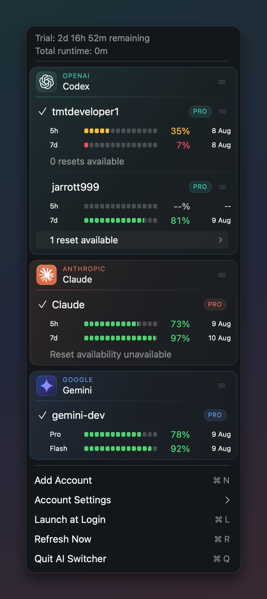

# AI Switcher

**Track quota, switch accounts, and organize Codex, Claude, and Gemini logins from your Mac’s menu bar.**

Keep multiple AI CLI logins in one compact native menu-bar panel—view remaining
capacity and reset dates, track Gemini usage from **Antigravity CLI (`agy`)** or
**Gemini CLI (`gemini`)**, drag to reorder accounts and provider sections, and
switch active credentials independently. Built with Swift 6, SwiftUI, and AppKit
for macOS 14+, with English and Simplified Chinese interfaces.

**English** · [简体中文](README.zh-CN.md)

[Features](#features) · [Quick start](#quick-start) · [Usage](#usage) ·
[Compatibility](#compatibility) · [Local data](#local-data-and-credentials) ·
[Troubleshooting](#troubleshooting) · [Development](#development) ·
[Documentation](#documentation)

<p align="center">
  
</p>

## Features

- **Three providers, independent active slots.** Manage **OpenAI Codex**,
  **Anthropic Claude**, and **Google Gemini** in one menu bar app, each tracking
  its own active account independently.
- **Gemini via Antigravity (`agy`) and Gemini CLI (`gemini`).**
  - **Antigravity CLI (`agy`)**: one-click setup installs a minimal `statusLine`
    hook that automatically records each signed-in Google account’s email, plan
    tier, and 5-hour / 7-day Gemini quota—without reading Keychain secrets or
    conversation data.
  - **Gemini CLI (`@google/gemini-cli`)**: discovers, snapshots, switches, and
    refreshes `~/.gemini/oauth_creds.json` accounts and fetches Pro / Flash
    daily quota buckets.
- **Drag-and-drop ordering everywhere.** Drag provider section headers to
  reorder sections (Codex / Claude / Gemini) and drag account cards to reorder
  logins within each provider—in both the menu-bar dropdown and **Account
  Settings** (plus keyboard-accessible move controls). Saved order persists in
  `accounts.json` and stays synchronized with the hover account submenu.
- **Quota at a glance.** Color-coded segmented bars show **remaining capacity**
  (red below 10%, yellow 10%–50%, green above 50%), reset dates, and plan
  badges. Unavailable values always remain `--%` / `--` and are never faked as
  zero.
- **Flexible account onboarding & recovery.** Add logins via one-click
  Antigravity (`agy`) tracking, isolated browser OAuth (`codex` / `gemini`) or
  CLI OAuth (`claude`), importing the current CLI login, or importing a
  credential JSON file. Expired tokens refresh automatically, matching CLI
  rotations are adopted, and reauthorizing an account updates it in place.
- **Confirmed Codex reset credits.** View available Codex manual reset credits
  and redeem one only after an explicit confirmation alert.
- **Native macOS experience.** Translucent AppKit menu panel, 5-minute
  background refresh, manual refresh (`⌘R`), custom account names, Launch at
  Login (`⌘L`), persistent SQLite total runtime, and instant English / Chinese
  switching. Zero third-party Swift package dependencies.

## Quick start

### Requirements

| Requirement | Details |
| --- | --- |
| Operating system | macOS 14 Sonoma or later |
| Build tools | Swift 6.0+ and a macOS SDK (Xcode or Command Line Tools) |
| Providers | Any combination of Codex CLI (`codex`), Claude Code (`claude`), Antigravity CLI (`agy`), and/or Gemini CLI (`gemini`) |
| Network | Required for browser OAuth, Codex/Claude/Gemini CLI quota refresh, and Codex reset credits |

You only need the providers you actually use.

### Build and launch

Run from the repository root:

```bash
git clone https://github.com/Jarrott/MacAI-Switcher.git
cd MacAI-Switcher
./build-app.sh release
open "$(swift build -c release --show-bin-path)/AI Switcher.app"
```

If you already have a local checkout, run the last two commands from its root
directory (where `Package.swift` lives). `./build-app.sh release` builds the
production binary, bundles artwork and translations, and ad-hoc signs the app;
`swift build` alone does not assemble the `.app` bundle.

Look for the switch icon in the **macOS menu bar** (there is no Dock icon or
main window). For everyday use, quit the app, copy `AI Switcher.app` into
`/Applications` in Finder, and launch that copy. Enable **Launch at Login** from
the menu if desired.

## Usage

### Add accounts

At startup, AI Switcher discovers existing logins from supported local stores.
To add another account or enable Gemini tracking, open **Add Account** (`⌘N`),
pick **Codex**, **Claude**, or **Gemini**, and choose an action:

| Action | Best for | Result |
| --- | --- | --- |
| **Enable Antigravity (`agy`) Usage Recording** | Tracking Gemini quota from `agy` | Installs the documented `statusLine` hook into `~/.gemini/antigravity-cli/settings.json` and syncs recorded `agy` accounts |
| **Sign In with Browser** | Adding or reauthorizing `codex`, `claude`, or `gemini` CLI | Runs the installed CLI’s official browser OAuth flow, then imports and activates the validated login |
| **Import Current Login** | CLI is already signed in (or `agy` has recorded usage) | Snapshots or updates the current login and marks it active for its provider |
| **Import Credential File…** | Importing an exported credential JSON | Validates and snapshots the file without replacing your active CLI login |

Manual terminal login commands:

```bash
codex login          # Codex / ChatGPT
claude auth login    # Claude Code
agy                  # Antigravity CLI (keychain Google sign-in; use /usage to check quota)
gemini               # Gemini CLI (Sign in with Google)
```

### Track Gemini usage with Antigravity CLI (`agy`)

When `agy` is installed on your Mac:

1. Open **Add Account → Gemini** and click **Enable Antigravity (`agy`) Usage Recording**.
   - AI Switcher writes an owner-only script (`agy-statusline-hook.sh`) and adds
     it to `~/.gemini/antigravity-cli/settings.json` with
     `stack_with_default: true`.
   - All existing `agy` settings remain untouched, the built-in status line
     stays visible, and any pre-existing custom `statusLine.command` is chained.
2. Start a new `agy` session (or run `/statusline` in an open session), then
   send a prompt or run `/usage`.
3. Open the AI Switcher menu bar icon or press **Refresh Now (`⌘R`)** to see
   your recorded **Google / Gemini** email, plan badge, 5-hour / 7-day
   remaining quota bars, and reset dates.

`agy` manages its own OS keyring sign-in. To switch Google accounts in `agy`,
run `/logout` inside `agy` and sign in again—AI Switcher keeps a separate card
for each recorded Google account automatically.

### Reorder accounts and provider sections

- **In the menu-bar dropdown**:
  - Drag any **provider section header** (OpenAI / Anthropic / Google) up or
    down to reorder provider groups.
  - Drag an account card’s **trailing drag handle (`≡`)** or its display-only
    **usage rows** to reorder accounts within that provider. Clicking the
    account title row continues to switch accounts normally.
- **In Account Settings**:
  - Drag account rows within each provider section to reorder them.
  - Drag provider section headers—or use the keyboard-accessible **↑ / ↓**
    buttons—to reorder sections.
- **Persistence & sync**: ordering is saved to `accounts.json` immediately,
  preserved across refreshes, re-logins, and restarts, and reflected across the
  menu dropdown, hover account submenu, and **Account Settings**.

### Switch accounts

1. Click an account’s **title row**, or hover **Account Settings** and choose a
   login from the submenu.
2. Confirm the **✓** beside the active account. Codex, Claude, and Gemini each
   maintain their own active selection.
3. Launch a CLI session that loads the selected credential.

Before replacing a live credential, AI Switcher snapshots the current live
credential so CLI token rotations are never lost. Already-running CLI sessions
or shared background daemons may continue using their previous login until
restarted; see [Codex terminal integration](docs/CODEX_TERMINALS.md) for the
optional zsh wrapper and session recovery steps.

### Read usage, reset credits, and shortcuts

- Percentages represent **remaining quota**: red `< 10%`, yellow `10%–50%`,
  green `> 50%`. Missing values stay `--%` / `--`.
- Usage bars and dates are display-only (and draggable when reordering).
- A positive Codex reset-credit count renders as a separate row that opens an
  explicit confirmation alert before consuming a credit.
- Refresh errors retain the last successful usage snapshot alongside an inline
  warning so cached values are never wiped out by transient network issues.

Keyboard shortcuts while the menu is open:

| Shortcut | Action |
| --- | --- |
| `⌘N` | Add Account |
| `⌘R` | Refresh Now |
| `⌘L` | Toggle Launch at Login |
| `⌘Q` | Quit AI Switcher |

## Compatibility

| Capability | Codex / OpenAI | Claude / Anthropic | Gemini / Google |
| --- | --- | --- | --- |
| Supported CLI | Codex CLI (`codex`) | Claude Code (`claude`) | Antigravity CLI (`agy`) and/or Gemini CLI (`gemini`) |
| Credential / data source | `~/.codex/auth.json` | macOS Keychain `Claude Code-credentials` | `agy` `statusLine` cache (`antigravity-usage.json`) and/or `~/.gemini/oauth_creds.json` |
| Additional local files | Identity parsed from credential JWT | Fallback `~/.claude/.credentials.json`; read-only `~/.claude.json` | `~/.gemini/antigravity-cli/settings.json` (`agy`); `~/.gemini/google_accounts.json` (`gemini`) |
| Quota windows | 5-hour / 7-day | 5-hour / 7-day | 5-hour / 7-day (`agy`); Pro / Flash daily (`gemini`) |
| Account switching | Supported (isolated `CODEX_HOME` OAuth) | Supported (system Keychain writer) | Supported for `gemini` CLI (`GEMINI_CLI_HOME`); `agy` switches via `/logout` |
| Manual reset credits | Supported when provided | Not supported | Not supported |
| Independent active slot | Yes | Yes | Yes |

Notes:

- Codex OS-keyring-only credentials, custom `CODEX_HOME` paths, and API-key-only
  profiles are not managed by the Codex store.
- Claude switching requires an initialized, writable Keychain item; a fallback
  file alone cannot complete a switch on macOS.
- Gemini CLI token refresh resolves public desktop OAuth client metadata from
  the local `gemini` CLI package (or `GEMINI_OAUTH_CLIENT_ID` /
  `GEMINI_OAUTH_CLIENT_SECRET`); no OAuth client secret is stored in this
  repository.
- Codex, Claude, and Gemini CLI usage endpoints are undocumented provider
  backend APIs and may change; `agy` uses its officially documented `statusLine`
  contract. Details are in [API.md](docs/API.md).

## Local data and credentials

App-managed data lives under `~/Library/Application Support/AISwitcher/`:

| Path | Permissions | Contents |
| --- | --- | --- |
| `accounts.json` | User | Account metadata, custom names, saved account/section order, active selections, and cached usage |
| `codex-accounts/` | `0700` / `0600` | Saved Codex credential snapshots |
| `claude-accounts/` | `0700` / `0600` | Saved Claude credential snapshots |
| `gemini-accounts/` | `0700` / `0600` | Saved Gemini CLI credential snapshots |
| `antigravity-usage.json` | `0600` | Sanitized `agy` usage snapshots (`email`, `plan_tier`, `quota`, timestamp only—no tokens, prompts, or paths) |
| `agy-statusline-hook.sh` | `0700` | Recorder script invoked by `agy` `statusLine` |
| `runtime.sqlite` | User | Accumulated app runtime in milliseconds; no credentials or event history |

Credential snapshots are atomic owner-only (`0600`) JSON files, **not an
encrypted vault**. Never commit snapshots, live credentials, or `accounts.json`
to Git or attach them to bug reports.

Codex (`CODEX_HOME`) and Gemini CLI (`GEMINI_CLI_HOME` with
`GEMINI_FORCE_FILE_STORAGE=true`) browser OAuth runs inside temporary isolated
directories so cancelling or failing never disrupts the active login. Runtime
checkpoints every minute and on normal exit; see
[DATABASE.md](docs/DATABASE.md) for schema and rollback details.

## Troubleshooting

| Symptom | What to do |
| --- | --- |
| `swift build --show-bin-path` says `Could not find Package.swift` | Run the command from the repository root (`cd /path/to/AI-Switcher`), or launch the built `.app` directly by its full path. |
| No window appears after launch | Look for the switch icon in the macOS menu bar; this is a menu-bar-only app without a Dock icon. |
| Gemini says `gemini` CLI is not installed | If you use **Antigravity CLI (`agy`)**, click **Enable Antigravity (`agy`) Usage Recording** instead. If you use **Gemini CLI**, install it via `npm install -g @google/gemini-cli` or `brew install gemini-cli`. |
| Enabled `agy` recording, but no Gemini card appears yet | Open a fresh `agy` session (or run `/statusline` in an existing one) and send a prompt or run `/usage`, then click the AI Switcher menu bar icon or press `⌘R`. |
| Codex reports an expired login or 401 | Press **Refresh Now (`⌘R`)**, or use **Import Current Login**. If authorization was revoked, sign in with the browser to the **same account**; its row, custom name, order, and cached usage are preserved. |
| Claude cannot refresh or activate | Import a valid current CLI login or sign in again. A missing Keychain item must be created by Claude’s own login flow first. For permission prompts or ACL repair, see [Claude Keychain recovery](docs/FUNCTIONAL.md#claude-keychain-recovery). |
| An already-open Codex terminal keeps using the old account | See [Codex terminal integration](docs/CODEX_TERMINALS.md); existing sessions do not switch automatically. |
| Quota or reset credits show `--%` / unavailable | Check the inline account error and press `⌘R`. Missing fields remain unknown and are never converted to zero. |

## Development

From the repository root:

```bash
swift format lint --configuration .swift-format --recursive Sources Tests Package.swift
swift test
./build-app.sh release
```

All 103 unit tests use synthetic payloads, injected transports, and isolated
temporary directories—no real accounts, Keychain items, or network calls are
used.

### Offscreen UI previews

After running `./build-app.sh release`, render English and Simplified Chinese
previews without opening the live menu:

```bash
BIN="$(swift build -c release --show-bin-path)/AI Switcher.app/Contents/MacOS/AISwitcher"
AISWITCHER_RENDER=/tmp/aiswitcher-en.png AISWITCHER_LANG=en "$BIN"
AISWITCHER_RENDER=/tmp/aiswitcher-zh.png AISWITCHER_LANG=zh-Hans "$BIN"
```

Previews use synthetic data by default and do not modify `accounts.json` or
`runtime.sqlite`. Optional environment variables:

| Variable | Value | Purpose |
| --- | --- | --- |
| `AISWITCHER_SCENARIO` | `codex-auth-error` | Preview the Codex authentication recovery state |
| `AISWITCHER_SURFACE` | `account-switcher` | Render the hover account submenu |
| `AISWITCHER_REAL` | `1` | Render local persisted data (may contain personal information) |

### Project structure

```text
Sources/AISwitcher/
  AISwitcherApp.swift     # App entry point and lifecycle
  Models/                 # Accounts, providers, plans, usage windows, reset credits
  Services/               # AccountsManager, credential & agy stores, OAuth/HTTP, runtime
  Views/                  # Menu panel, drag-reorder geometry, settings, add-account UI
  Resources/              # Provider SVGs, menu bar icon, en / zh-Hans localizations
  PreviewRenderer.swift   # Offscreen English / Chinese UI previews
Tests/AISwitcherTests/    # Usage parsing, Codex/Claude/Gemini/agy auth, reordering, runtime
scripts/                  # Optional Codex shell integration and Keychain checks
patches/                  # Optional version-specific Codex CLI patches
docs/                     # Functional, API, database, and integration documentation
```

See [AGENTS.md](AGENTS.md) for architecture and verification rules. Keep
credential access inside `Services/*CredentialStore.swift`, state in
`AccountsManager`, user-facing strings in both `en.lproj` and `zh-Hans.lproj`,
and synthetic parser tests for every provider mapping.

## Documentation

| Document | Covers |
| --- | --- |
| [Functional specification](docs/FUNCTIONAL.md) | Account flows, drag reordering, UI behavior, login recovery, and Claude Keychain repair |
| [Provider API reference](docs/API.md) | Codex, Claude, Gemini CLI, and Antigravity `statusLine` payload and OAuth contracts |
| [Local database](docs/DATABASE.md) | Runtime SQLite schema, migrations, backup, and rollback |
| [Codex terminal integration](docs/CODEX_TERMINALS.md) | Optional zsh launcher and existing-session handling |
| [Codex status email repair](docs/CODEX_STATUS_EMAIL.md) | Optional client patch scoped to Codex 0.159.0 |
| [Codex input extension](docs/CODEX_INPUT.md) | Optional rounded input frame and AI draft suggestions for that patched client |
| [Changelog](CHANGELOG.md) | Detailed implementation changes and fixes |

The Codex client patches are independent, optional extensions; building AI
Switcher does not compile or modify the Codex CLI.

## Project notes

AI Switcher is an independent tool. OpenAI, Codex, Anthropic, Claude, Google,
Gemini, Antigravity, and their artwork belong to their respective owners; their
use identifies supported services and does not imply endorsement or partnership.

This repository does not currently include a license file.
