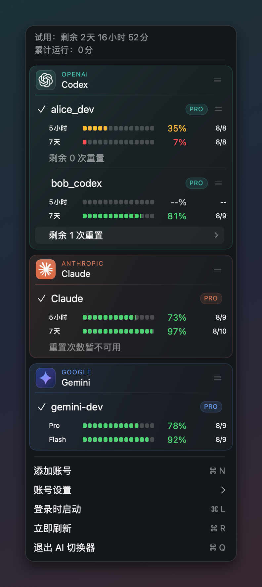

# AI Switcher

**Switch Codex and Claude accounts from your Mac’s menu bar.**

Keep multiple CLI logins in one place, see their remaining quota, and choose the
account you want to use next. Built with SwiftUI and AppKit for macOS, with English
and Simplified Chinese interfaces.

**English** · [简体中文](README.zh-CN.md)

[Quick start](#quick-start) · [Usage](#usage) · [Compatibility](#compatibility) ·
[Troubleshooting](#troubleshooting) · [Development](#development) · [Documentation](#documentation)

<p align="center">
  
</p>

## Features

- **Multiple accounts, two providers.** Keep one Codex account and one Claude
  account active independently. Switch from an account’s title or the account submenu.
- **Quota at a glance.** View remaining 5-hour and 7-day capacity, reset dates,
  and plan information when the provider supplies them.
- **Three ways to add accounts.** Sign in through the installed CLI’s browser
  flow, import its current login, or import a credential JSON file.
- **Credential recovery.** Refresh expired OAuth tokens and reconcile matching
  CLI token rotations. Reauthorize an existing account without deleting its row.
- **Codex reset credits.** View available credits and redeem one only after an
  explicit confirmation, when supported by the account.
- **Native desktop controls.** Automatic usage refresh every five minutes,
  manual refresh, custom account names, launch at login, persistent total runtime,
  and instant language switching.

## Quick start

### Requirements

| Requirement | Details |
| --- | --- |
| Operating system | macOS 14 Sonoma or later |
| Build tools | Swift 6.0+ and a macOS SDK, supplied by a compatible Xcode or Command Line Tools installation |
| Provider login | A Codex ChatGPT OAuth login and/or a Claude Code OAuth login |
| Browser sign-in | The corresponding `codex` or `claude` CLI must be installed |
| Network | Required for browser sign-in, usage refresh, and reset-credit redemption |

The Swift package has no third-party package dependencies and uses the system
SQLite library. You only need the provider you intend to use.

### Build and launch

```bash
git clone https://github.com/Jarrott/MacAI-Switcher.git
cd MacAI-Switcher
./build-app.sh release
open ".build/release/AI Switcher.app"
```

If you already have a checkout, run the last two commands from its root directory.
The script builds the executable, bundles artwork and translations, and attempts
ad-hoc signing. `swift build` alone does not assemble the `.app` bundle.

Look for the switching icon in the **macOS menu bar**; the app has no Dock icon or
main window. For regular use, quit the app, copy `AI Switcher.app` to Applications
in Finder, and launch that copy. Enable **Launch at Login** from its menu if desired.

## Usage

### Add your first account

At startup, AI Switcher looks for existing logins in the supported credential
stores. To add or repair a login, open **Add Account**, select **Codex** or
**Claude**, and choose an option:

| Option | When to use it | Result |
| --- | --- | --- |
| **Sign In with Browser** | Add another login or authorize an expired one | Runs the provider CLI’s OAuth flow, then imports and activates the validated login |
| **Import Current Login** | The CLI is already signed in | Saves or updates that login and marks it active for the provider |
| **Import Credential File** | You have a compatible provider credential JSON file | Validates and saves it; the current CLI login is not replaced until you activate it |

For a terminal-based login, use the appropriate command, then select
**Import Current Login**:

```bash
codex login          # Codex / ChatGPT
claude auth login    # Claude Code
```

Repeat for additional accounts. **Account Settings** lets you rename accounts,
activate a saved login, remove an inactive account after confirmation, and choose
the interface language. Active accounts cannot be removed until you switch away.

### Switch accounts

1. Click an account’s **title**, or hover **Account Settings** and select a login.
2. Check the **✓** beside the selected account. Codex and Claude each have their
   own active selection.
3. Start a CLI session that loads the selected credential.

The app snapshots the current live credential before replacing it. An existing
CLI session or shared background server may still hold its previous login;
the checkmark confirms credential selection, not a running session’s identity.
See [Codex terminal integration](docs/CODEX_TERMINALS.md) for the optional zsh
launcher, shared-server behavior, and safe session restart instructions.

### Read usage and reset credits

Percentages show **remaining quota**: red below 10%, yellow from 10% through 50%,
and green above 50%. Missing usage or reset dates appear as `--%` / `--`.
Unavailable reset-credit data is never treated as zero.

Usage bars and dates are read-only. A positive Codex reset-credit row opens a
confirmation dialog; only confirming sends the redemption request. Refresh
failures retain the last successful usage snapshot and display an account error,
so cached values may be out of date.

With the menu open:

| Shortcut | Action |
| --- | --- |
| `⌘N` | Add Account |
| `⌘R` | Refresh Now |
| `⌘L` | Toggle Launch at Login |
| `⌘Q` | Quit |

## Compatibility

| Capability | Codex / OpenAI | Claude / Anthropic |
| --- | --- | --- |
| Managed login | ChatGPT OAuth through Codex CLI | Claude Code OAuth |
| Live credential | `~/.codex/auth.json` | macOS Keychain service `Claude Code-credentials` |
| Additional local data | Account identity from the credential | File fallback at `~/.claude/.credentials.json`; identity read from `~/.claude.json` |
| Usage | 5-hour / 7-day windows when returned | 5-hour / 7-day windows when returned |
| Manual reset credits | When available from the provider | Not supported |
| Active accounts | One | One, independent of Codex |

Codex credentials stored only in the OS keyring or under a custom `CODEX_HOME`
are not managed by the current store. API-key-only profiles are not supported by
the account import flow. Claude switching requires a writable, initialized
Keychain login item; a fallback file alone cannot complete a macOS switch.

Usage and reset-credit integrations rely on undocumented provider backend APIs,
which can change. Available fields and actions depend on the account and provider
response. Request formats and recovery behavior are documented in [API.md](docs/API.md).

## Local data and credentials

App-managed data lives under `~/Library/Application Support/AISwitcher/`:

| Path | Contents |
| --- | --- |
| `accounts.json` | Account metadata, custom names, active selections, and cached usage |
| `codex-accounts/` | Saved Codex credential snapshots |
| `claude-accounts/` | Saved Claude credential snapshots |
| `runtime.sqlite` | Accumulated app runtime in milliseconds; no credentials or event history |

Credential snapshots are sensitive JSON files, written atomically with owner-only
`0600` permissions inside `0700` snapshot directories. They are **not an encrypted
vault**. Keep snapshots, live credentials, and account metadata out of commits,
issue attachments, and shared screenshots.

The app communicates directly with provider services for usage, token refresh,
and confirmed reset actions. Claude credentials also use the macOS Keychain;
`~/.claude.json` is read only. Codex browser sign-in runs in a temporary isolated
`CODEX_HOME` and activates the new credential only after validation.

Runtime is saved every minute and on normal exit; time while the app is closed
does not count. See [database documentation](docs/DATABASE.md) for backup and
rollback procedures.

## Troubleshooting

| Symptom | What to do |
| --- | --- |
| No window appears after launch | Open the menu-bar icon. This is a menu-bar app with no Dock icon. |
| Browser sign-in cannot find a CLI | Confirm the chosen provider is installed and its login command runs in Terminal. You can sign in there, then use **Import Current Login**. |
| Codex reports an expired login or 401 | Try **Refresh Now**, then import a valid current CLI login. If authorization was revoked, sign in with the browser to the **same account**; its row, custom name, and cached usage are retained. |
| Claude cannot refresh or activate | Use **Import Current Login** for a valid CLI login, or sign in again. A missing Keychain item must first be initialized by Claude’s login flow. For permission errors or repeated prompts, see [Keychain recovery](docs/FUNCTIONAL.md#claude-keychain-recovery). |
| A terminal still uses the previous Codex account | Follow [terminal integration and session recovery](docs/CODEX_TERMINALS.md). Already-running sessions are not switched automatically. |
| Quota or reset credits show unavailable | Check the account error and refresh again. The provider may omit the field or reject the request; unavailable does not mean zero. |

## Development

From the repository root, run the checks relevant to your change:

```bash
swift format lint --configuration .swift-format --recursive Sources Tests Package.swift
swift test
./build-app.sh release
```

Tests use synthetic provider payloads, injected transports, and isolated temporary
storage. The regular suite does not require live provider credentials. Optional
shell-integration and Keychain checks are described in the linked feature docs.

### UI previews

After a release build, render both interface languages without opening the menu:

```bash
AISWITCHER_RENDER=/tmp/aiswitcher-en.png AISWITCHER_LANG=en \
  .build/release/AISwitcher
AISWITCHER_RENDER=/tmp/aiswitcher-zh.png AISWITCHER_LANG=zh-Hans \
  .build/release/AISwitcher
```

Previews use synthetic accounts by default, require no provider requests, and do
not change the runtime database. Additional environment options:

| Variable | Value | Purpose |
| --- | --- | --- |
| `AISWITCHER_SCENARIO` | `codex-auth-error` | Preview the Codex authentication error state |
| `AISWITCHER_SURFACE` | `account-switcher` | Render the account submenu |
| `AISWITCHER_REAL` | `1` | Opt in to saved account/usage data; the image may contain personal information |

### Project structure

```text
Sources/AISwitcher/
  AISwitcherApp.swift     # App entry point and lifecycle
  Models/                # Accounts, plans, usage windows, reset credits
  Services/              # Account state, credential stores, provider HTTP, runtime
  Views/                 # Menu panel, account management, native controls
  Resources/             # Artwork and English / Simplified Chinese strings
  PreviewRenderer.swift  # Offscreen UI previews
Tests/AISwitcherTests/    # Usage, authentication, switching, and persistence tests
scripts/                 # Optional Codex shell integration and validation tools
patches/                 # Optional version-specific Codex client patches
docs/                    # Functional, API, storage, and integration documentation
```

Read [AGENTS.md](AGENTS.md) before contributing. Keep credential access in the
provider stores and account state in `AccountsManager`; update both localizations
for UI text and add synthetic parser tests for new provider response mappings.
Keep both READMEs and the relevant feature docs in sync when behavior changes.

## Documentation

| Document | Covers |
| --- | --- |
| [Functional specification](docs/FUNCTIONAL.md) | Account flows, UI behavior, login recovery, and Claude Keychain repair |
| [Provider API reference](docs/API.md) | Usage payloads, OAuth renewal, and reset-credit contracts |
| [Local database](docs/DATABASE.md) | Runtime schema, migration, backup, and rollback |
| [Codex terminal integration](docs/CODEX_TERMINALS.md) | Optional zsh launcher and existing-session handling |
| [Codex status email repair](docs/CODEX_STATUS_EMAIL.md) | Optional client patch scoped to Codex 0.159.0 |
| [Codex input extension](docs/CODEX_INPUT.md) | Optional rounded input and AI draft suggestions for that patched client |
| [Changelog](CHANGELOG.md) | Implementation changes and fixes |

The Codex client patches are separate, optional extensions; building AI Switcher
does not build or install a patched Codex CLI.

## Project notes

AI Switcher is an independent tool. OpenAI, Codex, Anthropic, Claude, and their
artwork belong to their respective owners; their use identifies supported services
and does not imply endorsement or partnership.

This repository does not currently include a license file.
