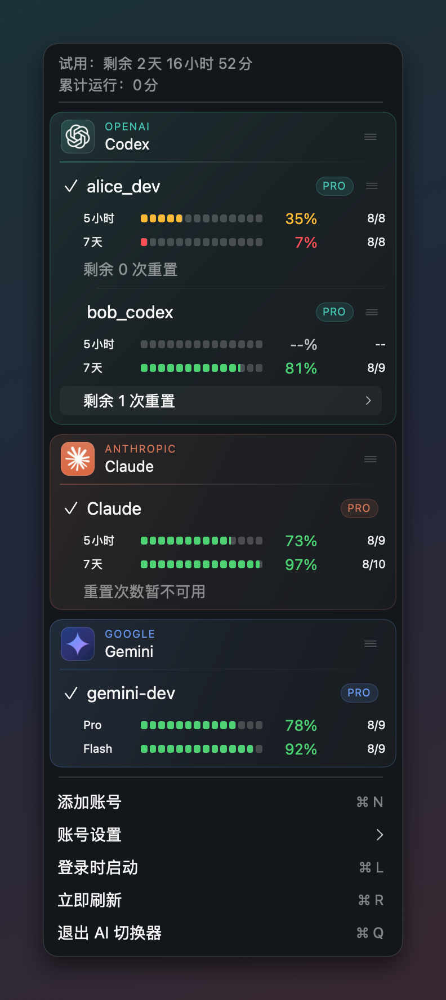

# AI Switcher

**在 macOS 菜单栏中切换 Codex 与 Claude 账号。**

集中管理多个 CLI 登录账号，查看剩余额度，选择下一次使用的账号。
使用 SwiftUI 与 AppKit 构建，支持英文和简体中文界面。

[English](README.md) · **简体中文**

[快速开始](#快速开始) · [使用指南](#使用指南) · [兼容范围](#兼容范围) ·
[常见问题](#常见问题) · [开发指南](#开发指南) · [文档导航](#文档导航)

<p align="center">
  
</p>

## 主要功能

- **多账号、双服务商**：Codex 与 Claude 分别维护当前账号，互不影响；点击账号标题或通过账号子菜单即可切换。
- **额度一目了然**：展示服务商返回的 5 小时、7 天剩余额度、重置时间和套餐信息。
- **三种添加方式**：调用已安装 CLI 的浏览器登录流程、导入当前登录，或导入凭据 JSON 文件。
- **登录恢复**：刷新过期的 OAuth 令牌，同步同一账号被 CLI 更新的凭据；重新授权无需先删除账号。
- **Codex 重置次数**：在账号支持时显示可用次数，经明确确认后消耗一次进行额度重置。
- **原生桌面体验**：每 5 分钟自动刷新、手动刷新、自定义账号名称、登录时启动、累计运行时间，以及即时语言切换。

## 快速开始

### 环境要求

| 项目 | 要求 |
| --- | --- |
| 操作系统 | macOS 14 Sonoma 或更新版本 |
| 编译工具 | Swift 6.0+ 与 macOS SDK，由兼容版本的 Xcode 或 Command Line Tools 提供 |
| 账号类型 | Codex 的 ChatGPT OAuth 登录，或 Claude Code 的 OAuth 登录 |
| 浏览器登录 | 已安装对应的 `codex` 或 `claude` CLI |
| 网络 | 浏览器登录、额度刷新和消耗重置次数需要联网 |

Swift 包没有第三方包依赖，使用系统自带的 SQLite。只需配置你实际使用的服务商。

### 编译并启动

```bash
git clone https://github.com/Jarrott/MacAI-Switcher.git
cd MacAI-Switcher
./build-app.sh release
open ".build/release/AI Switcher.app"
```

如果已经有本地仓库，在项目根目录执行最后两条命令即可。
脚本会编译程序、打包图片与翻译资源，并尝试进行 ad-hoc 签名；单独执行 `swift build` 不会生成完整的 `.app`。

启动后，在 **macOS 顶部菜单栏**找到切换图标。应用没有 Dock 图标，也不会打开主窗口。
日常使用时，可先退出应用，在 Finder 中将 `AI Switcher.app` 复制到“应用程序”，再启动该副本。
需要随系统登录启动时，在菜单中启用**登录时启动**。

## 使用指南

### 添加第一个账号

应用启动时会在支持的凭据位置查找已有登录。需要新增账号或修复登录时，
打开**添加账号**，选择 **Codex** 或 **Claude**，再选择以下方式：

| 操作 | 适用情况 | 执行结果 |
| --- | --- | --- |
| **使用浏览器登录** | 添加另一个账号，或为失效的登录重新授权 | 调用对应 CLI 的 OAuth 流程，验证成功后导入并激活账号 |
| **导入当前登录** | 已经在 CLI 中登录 | 保存或更新当前登录，并标记为该服务商的当前账号 |
| **导入凭据文件** | 已有符合服务商格式的凭据 JSON 文件 | 校验并保存；手动激活前不会替换 CLI 当前登录 |

也可以先在终端执行对应的登录命令，再点击**导入当前登录**：

```bash
codex login          # Codex / ChatGPT
claude auth login    # Claude Code
```

重复上述流程即可添加更多账号。**账号设置**支持修改名称、切换账号、确认移除非当前账号，以及选择界面语言。
当前账号受删除保护，需要先切换到同一服务商的其他账号才能移除。

### 切换账号

1. 点击账号的**标题行**，或将鼠标移到**账号设置**，在子菜单中选择账号。
2. 查看账号旁的 **✓**。Codex 和 Claude 各自拥有独立的当前账号。
3. 启动会重新读取所选凭据的 CLI 会话。

替换凭据前，应用会先保存当前实际登录的凭据快照。
已经运行的 CLI 会话或共享后台服务可能仍缓存旧登录；勾选标记表示凭据已选中，不代表现有会话已经切换。
可选的 zsh 启动脚本、共享服务行为及安全重启步骤见 [Codex 终端集成](docs/CODEX_TERMINALS.md)。

### 查看额度与重置次数

百分比表示**剩余额度**：低于 10% 为红色，10%～50% 为黄色，高于 50% 为绿色。
服务商没有返回的额度或时间显示为 `--%` / `--`；无法获取的重置次数不会显示成零。

额度条与时间仅用于展示。Codex 有可用重置次数时，点击对应行会先弹出确认框，
确认后才会发出消耗请求。刷新失败会保留上次成功的数据并显示账号错误，因此旧额度可能已经过时。

菜单打开时可使用以下快捷键：

| 快捷键 | 操作 |
| --- | --- |
| `⌘N` | 添加账号 |
| `⌘R` | 立即刷新 |
| `⌘L` | 切换“登录时启动” |
| `⌘Q` | 退出 |

## 兼容范围

| 能力 | Codex / OpenAI | Claude / Anthropic |
| --- | --- | --- |
| 管理的登录类型 | Codex CLI 的 ChatGPT OAuth 登录 | Claude Code OAuth 登录 |
| 实际登录凭据 | `~/.codex/auth.json` | macOS 钥匙串中的 `Claude Code-credentials` 项 |
| 其他本地数据 | 从凭据中解析账号身份 | 备用文件 `~/.claude/.credentials.json`；只读 `~/.claude.json` 获取身份 |
| 额度窗口 | 服务商返回时显示 5 小时 / 7 天额度 | 服务商返回时显示 5 小时 / 7 天额度 |
| 手动重置次数 | 服务商提供时可用 | 不支持 |
| 当前账号 | 一个 | 一个，与 Codex 独立 |

当前 Codex 存储实现不管理仅保存在系统钥匙串中的凭据，也不读取自定义 `CODEX_HOME`。
账号导入流程不支持仅包含 API Key 的配置。Claude 切换需要已初始化且可写的钥匙串登录项，
仅有备用文件不能完成 macOS 上的账号切换。

额度和重置功能使用服务商未公开承诺稳定性的后端接口，接口可能变化；
具体可用字段与操作取决于账号和实际响应。请求格式与恢复机制见 [API 文档](docs/API.md)。

## 本地数据与凭据

应用管理的数据位于 `~/Library/Application Support/AISwitcher/`：

| 路径 | 内容 |
| --- | --- |
| `accounts.json` | 账号元数据、自定义名称、当前账号选择和额度缓存 |
| `codex-accounts/` | Codex 凭据快照 |
| `claude-accounts/` | Claude 凭据快照 |
| `runtime.sqlite` | 以毫秒记录的累计运行时间，不包含凭据或事件历史 |

凭据快照是敏感 JSON 文件，采用原子写入，文件权限为仅当前用户可读写的 `0600`，
快照目录权限为 `0700`。这些文件**并非加密保险库**。
请勿将凭据快照、实际登录凭据或账号元数据提交到仓库、上传到 Issue，或放入公开截图。

额度查询、令牌刷新和确认后的重置请求直接与服务商通信。
Claude 凭据还涉及系统钥匙串，应用只读取 `~/.claude.json`。
Codex 浏览器登录在临时隔离的 `CODEX_HOME` 中完成，验证成功后才激活新凭据。

累计运行时间每分钟及正常退出时保存；应用关闭期间不计时。
备份与回退方式见 [数据库文档](docs/DATABASE.md)。

## 常见问题

| 问题 | 处理方式 |
| --- | --- |
| 启动后没有窗口 | 点击顶部菜单栏图标；本应用没有 Dock 图标和主窗口。 |
| 浏览器登录提示找不到 CLI | 确认已安装所选服务商的 CLI，并能在终端执行对应登录命令。也可以先在终端登录，再选择**导入当前登录**。 |
| Codex 提示登录失效或 401 | 先尝试**立即刷新**，再导入有效的 CLI 当前登录。如果授权已撤销，使用浏览器重新登录**同一账号**；原有条目、自定义名称及额度缓存会保留。 |
| Claude 无法刷新或切换 | 有效的 CLI 登录可通过**导入当前登录**更新；否则重新登录。缺少钥匙串登录项时，先通过 Claude 自身登录流程初始化。权限错误或反复弹窗见[钥匙串恢复](docs/FUNCTIONAL.md#claude-keychain-recovery)。 |
| 终端中的 Codex 仍使用旧账号 | 按 [终端集成与会话恢复](docs/CODEX_TERMINALS.md) 处理；已有会话不会自动切换。 |
| 额度或重置次数显示不可用 | 查看账号错误并重试刷新。服务商可能没有返回该字段，或请求失败；“不可用”不等于零。 |

## 开发指南

在项目根目录按修改范围执行相应检查：

```bash
swift format lint --configuration .swift-format --recursive Sources Tests Package.swift
swift test
./build-app.sh release
```

测试使用合成的服务商响应、可注入的网络请求实现和隔离的临时存储，常规测试无需真实账号凭据。
可选的 shell 集成测试与钥匙串检查见对应专题文档。

### 界面预览

完成 release 编译后，可以直接生成中英文预览，无需点击菜单栏：

```bash
AISWITCHER_RENDER=/tmp/aiswitcher-en.png AISWITCHER_LANG=en \
  .build/release/AISwitcher
AISWITCHER_RENDER=/tmp/aiswitcher-zh.png AISWITCHER_LANG=zh-Hans \
  .build/release/AISwitcher
```

预览默认使用合成账号，不请求服务商，也不修改运行时间数据库。还支持以下环境变量：

| 变量 | 值 | 用途 |
| --- | --- | --- |
| `AISWITCHER_SCENARIO` | `codex-auth-error` | 预览 Codex 登录错误状态 |
| `AISWITCHER_SURFACE` | `account-switcher` | 渲染账号子菜单 |
| `AISWITCHER_REAL` | `1` | 显式使用已保存的账号与额度数据；图片可能包含个人信息 |

### 项目结构

```text
Sources/AISwitcher/
  AISwitcherApp.swift     # 应用入口与生命周期
  Models/                # 账号、套餐、额度窗口与重置次数
  Services/              # 账号状态、凭据存储、服务商请求与运行时间
  Views/                 # 菜单面板、账号管理与原生控件
  Resources/             # 图片资源与英文、简体中文翻译
  PreviewRenderer.swift  # 离屏界面预览
Tests/AISwitcherTests/    # 额度解析、认证、切换与持久化测试
scripts/                 # 可选的 Codex shell 集成与验证工具
patches/                 # 针对特定 Codex 版本的可选客户端补丁
docs/                    # 功能、接口、存储与集成文档
```

贡献代码前请阅读 [AGENTS.md](AGENTS.md)。凭据读写应保留在对应服务商的存储层，
账号状态由 `AccountsManager` 统一管理。界面文案同时维护中英文；
新增服务商响应映射时补充合成数据解析测试。行为变化时同步更新两份 README 和相关功能文档。

## 文档导航

以下专题文档目前以英文维护：

| 文档 | 内容 |
| --- | --- |
| [功能规格](docs/FUNCTIONAL.md) | 账号流程、界面行为、登录恢复和 Claude 钥匙串修复 |
| [服务商 API](docs/API.md) | 额度响应、OAuth 续期与重置接口约定 |
| [本地数据库](docs/DATABASE.md) | 运行时间表结构、迁移、备份与回退 |
| [Codex 终端集成](docs/CODEX_TERMINALS.md) | 可选 zsh 启动脚本与现有会话处理 |
| [Codex 状态邮箱修复](docs/CODEX_STATUS_EMAIL.md) | 仅适用于 Codex 0.159.0 的可选客户端补丁 |
| [Codex 输入扩展](docs/CODEX_INPUT.md) | 上述补丁客户端的可选圆角输入框与 AI 草稿建议 |
| [变更记录](CHANGELOG.md) | 实现变更与修复记录 |

Codex 客户端补丁是独立的可选扩展；编译 AI Switcher 不会编译或安装修改版 Codex CLI。

## 项目说明

AI Switcher 是独立工具。OpenAI、Codex、Anthropic、Claude 及其图形标识归各自所有者所有；
使用这些名称和图形仅用于标识支持的服务，不代表官方背书或合作关系。

当前仓库尚未包含许可证文件。
